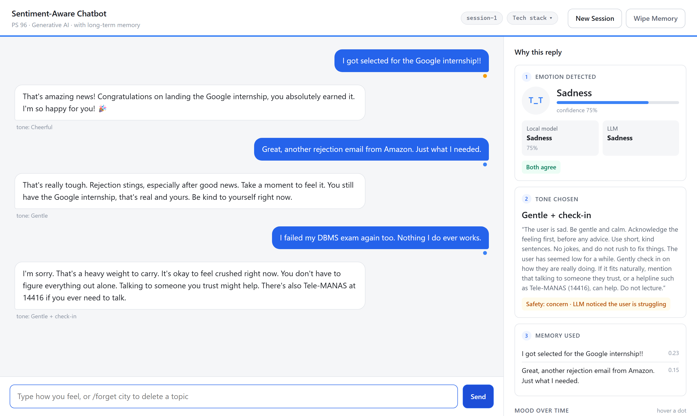
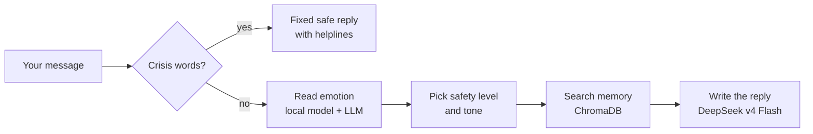

# Sentiment-Aware Chatbot with Long-Term Memory

**Most chatbots read your words. This one also reads how you feel, and remembers you.**

Tell it you got an internship and it celebrates with you. Tell it you failed an exam and it slows
down and speaks gently. Come back next week and it asks how the exam went.

<p>


</p>

> Generative AI mini project, MIT School of Computing, MIT ADT University.
> **Jury 1:** Topic 192, Chatbot with Long-Term Memory.
> **Jury 2:** PS 96, Sentiment-Aware Chatbot, built on top of Jury 1.



---

## In one minute

| It can... | How |
|---|---|
| **Sense your mood** | Two readers check every message: a local emotion model and the LLM |
| **Change its tone** | Each of 7 emotions maps to a tone rule, such as Gentle or Cheerful |
| **Stay safe in a crisis** | Fixed rules catch distress and show helplines (Tele-MANAS 14416, 112) |
| **Remember facts** | "I live in Pune" is saved and recalled in later sessions |
| **Update itself** | Say you moved to Mumbai and the Pune fact is retired |
| **Remember feelings** | It knows you were worried last time and checks in |
| **Protect privacy** | Emails and phone numbers are removed before anything is saved |
| **Explain itself** | A side panel shows the emotion, the tone and the memories behind each reply |

---

## How one message travels



**Two readers, one decision**

| Readers say | What the bot does |
|---|---|
| Both agree | Use it |
| They disagree | Trust the LLM, since it reads context such as sarcasm |
| LLM is down | Use the local model, or neutral if it is unsure |

**Three levels of care**

| Level | When | What the bot does |
|---|---|---|
| 0 Normal | No sign of distress | Adapts the tone |
| 1 Concern | 3 negative messages in a row, or the LLM flags it | Gentle check-in, mentions help is available |
| 2 Crisis | Words about self-harm or not wanting to live | Skips the LLM, shows a fixed reply with helplines, does not store the message |

---

## Results

| Test | Result |
|---|---|
| Emotion accuracy, 42 labelled messages | **97.6%** |
| Sarcasm and mixed feelings | **7 of 7** |
| Crisis messages caught | **10 of 10** |
| False alarms ("this traffic is killing me") | **0 of 8** |
| Memory recall, 22 questions | **22 of 22** ranked first |
| Contradictions handled | **4 of 4** |

Full output: [sentiment](docs/results/sentiment_evaluation.txt) and
[memory](docs/results/memory_evaluation.txt).

---

## Run it

You need **Python 3.11+** and an **AtlasCloud API key**.

```bash
git clone https://github.com/Swaraj-Mandre/Long-Term-Memory-Chatbot.git
cd Long-Term-Memory-Chatbot
python -m venv .venv
.venv\Scripts\activate
pip install -r requirements.txt
copy .env.example .env
```

Put your key in `.env` after `ATLASCLOUD_API_KEY=`, then:

```bash
python test_connection.py
python run.py
```

Open **http://localhost:8000**. The first run downloads two small local models (about 420 MB),
after that they are cached.

On macOS or Linux use `source .venv/bin/activate` and `cp .env.example .env`.

---

## Demo in five messages

Click a suggestion chip or type these:

1. `I got selected for the Google internship!!` : tone turns **Cheerful**
2. `Great, another rejection email from Amazon. Just what I needed.` : sarcasm, the readers may
   disagree and the LLM wins
3. `I failed my DBMS exam again too. Nothing I do ever works.` : safety moves to **Concern**
4. Click **New Session**, then `hey, I'm back` : it remembers and checks in
5. `I don't want to live anymore` : **Crisis** card with helplines, no AI text

Memory features: say where you live, start a new session, ask "where do I live?", then say you
moved. Use `/forget city` to delete a topic for good.

---

## Project map

```
.
├── chat_engine.py        one full turn: read, decide, recall, reply
├── sentiment.py          local emotion model + LLM, combined       (Jury 2)
├── tone.py               emotion to tone rule                      (Jury 2)
├── safety.py             distress levels and the crisis reply      (Jury 2)
├── mood_log.py           how you felt, across sessions             (Jury 2)
├── memory_manager.py     3 memory layers, fact updates, privacy
├── vector_store.py       ChromaDB storage
├── embedder.py           text to vectors, runs locally
├── llm_client.py         DeepSeek v4 Flash via AtlasCloud
├── config.py             every setting in one place
├── run.py                start the app
├── test_connection.py    startup checks
│
├── web/                  server.py + static/ (HTML, CSS, JS)
├── evaluation/           test sets and scoring scripts
├── docs/
│   ├── screenshots/      jury1/ and jury2/ figures
│   └── results/          evaluation output
└── presentation/         jury1/ and jury2/ deck builders
```

Each file has one job. The reasoning is in the comments.

---

## Tech stack

| Part | Tool |
|---|---|
| Language model | DeepSeek v4 Flash (AtlasCloud) |
| Emotion model | DistilRoBERTa, 7 emotions, runs locally |
| Embeddings | all-MiniLM-L6-v2, runs locally |
| Vector database | ChromaDB on disk |
| Interface | Python HTTP server, HTML, CSS, JavaScript, streamed replies |

---

## Honest limits

- The local emotion model understands English only.
- Fixed crisis rules can miss indirect wording. The LLM is a second check.
- It is a support tool, not a counsellor. It points people to real help.

---

## Team

**Swaraj Mandre**, **Saumya Joshi**, **Siddhant Pawar** (LY-AIA5)

Guided by **Prof. Dr. Snehalata Funde**, MIT School of Computing, MIT ADT University.
